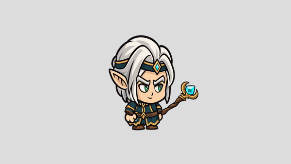

# Elfo mago

Personagem chibi com cabelo prateado, roupa verde-petróleo e cajado de cristal azul.
As texturas são próprias; a montagem, as durações e os movimentos partem do rig SCML
do Orc enviado como referência.

## Conteúdo

- `AI/`: SVG editável com grupos separados, PDF para Illustrator e SVGs por peça.
- `EPS/`: 13 peças vetorizadas.
- `PNG/Vector Parts/`: 13 peças PNG e `Animations.scml` para Spriter.
- `PNG/PNG Sequences/`: 207 frames transparentes de 900 × 900, em 17 animações.
- `Unity Package/`: pacote de sprites e script para reprodução dos frames.
- `TXT/`: instruções e créditos.
- `Sources/`: conceito e texturas geradas antes do registro no rig.
- `preview.gif`: Idle Blinking em loop, com fundo cinza em 600 × 338, inspirado no anexo.
- `casting.gif`: ataque com cajado e efeito de magia.
- `index.html`: prévia interativa das 17 animações, com pausa e controle de velocidade.

O cajado substitui `Sword.png` por `Staff.png`, com pivô e posição ajustados para
acompanhar a mão. As expressões usam três texturas independentes. Os nomes das
animações permanecem os do Orc para facilitar integração.

## Uso

Na raiz do repositório, execute `python -m http.server 8765 --bind 127.0.0.1` e
abra `/characters/elf-mage/` no servidor local. Para regenerar os PNGs, mantenha
o servidor ativo e execute `python tools/export_elf_mage.py` em outro terminal.
Requer Playwright e Chromium; `CHROMIUM_PATH` permite informar outro executável.

As peças PNG são a fonte das animações. SVG/PDF/EPS são vetorização das texturas;
não há arquivo `.ai` nativo. O pacote Unity foi verificado estruturalmente,
mas não foi importado no Editor Unity neste ambiente. A renderização Canvas,
as sequências PNG e os GIFs foram executados e conferidos.

Para registrar novamente os atlases em `Sources/`, execute `python tools/pack_elf_parts.py`
(requer Pillow e ImageMagick). Para reconstruir os vetores e o pacote Unity, com
o servidor ativo, execute `python tools/build_elf_extras.py` (requer vtracer,
Inkscape e Playwright). O rig editável é `PNG/Vector Parts/Animations.scml`;
`rig.json` contém a mesma montagem para o reprodutor web.
